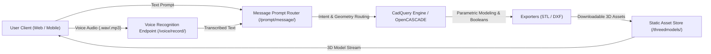

# Zenia Backend

> **Zenia** is an AI-powered CAD modeling backend that translates voice commands and natural language prompts into parametric 3D CAD geometries and exportable 3D models (STL, DXF).

---

## 📌 Overview

**Zenia** is built to revolutionize computer-aided design (CAD) by providing an intuitive, voice- and prompt-driven modeling workflow. Instead of navigating complex mouse and keyboard CAD menus, users can describe designs through voice or text. 

The Zenia backend:
1. **Captures and transcribes voice input** using automated speech recognition.
2. **Parses design intent and shape parameters** from conversational prompts.
3. **Executes parametric 3D operations** using **CadQuery** (OpenCASCADE-powered kernel) and Text-to-CAD services.
4. **Exports 3D models** in `.stl` and `.dxf` formats ready for real-time browser rendering (e.g. Three.js) or 3D printing.
5. **Provides secure authentication** with custom JWT tokens and user account management.

---

## 🚀 Key Features

- **🎙️ Voice Recognition Engine**:
  - Direct audio file upload and speech transcription via the Google Web Speech API and `speech_recognition`.
  - Scaffolding for real-time WebSocket audio streaming via Django Channels.

- **💬 Natural Language Prompt Processing**:
  - Translates freeform natural language prompts into geometric operations.
  - Automatically identifies target objects, dimensions, and modifications (e.g. "create a cube", "cuboid with hole", "create a gear", "create a chair").

- **🧱 Parametric Shape Generation (CadQuery / OpenCASCADE)**:
  - **Basic Geometries**: Sphere, Cube, Cuboid, Cone, Rectangle.
  - **Complex Shapes**: Chair, Gear, Hammer, Feeder, Saving Box, Bottle, Beam.
  - **Supported Object Discovery**: Query obtainable models dynamically via `/shapes_obtainable/`.

- **✂️ Advanced Geometry Modifications**:
  - Hollowing out objects and creating through-holes (e.g., hollow feeder, hollow bottle, perforated cuboid).
  - Shelling out material while preserving the outer shell.
  - Face selection, prism tagging, and circular cutouts with DXF output.

- **🔐 Authentication & Security**:
  - Custom User model with UUID public IDs and email verification.
  - Token-based authentication using **JWT** (`rest_framework_simplejwt`).
  - Account registration, activation emails, and profile management.

- **📚 Interactive API Documentation**:
  - Swagger UI: `/api/docs/`
  - ReDoc: `/redoc/`
  - OpenAPI Specification: `/swagger.json`

---

## 🏗️ System Architecture



---

## 📁 Project Structure

```text
zenia/
├── manage.py                          # Django management script
├── requirements.txt                   # Python dependencies
├── README.md                          # Project documentation
├── commands.txt                       # Server deployment commands
│
├── zenia/                             # Core project settings and URL configuration
│   ├── settings.py                    # App settings, DB, JWT, CORS, DRF config
│   ├── urls.py                        # Root URL routing and Swagger schema setup
│   ├── wsgi.py                        # WSGI entrypoint for web servers (Gunicorn)
│   └── asgi.py                        # ASGI entrypoint for Channels / WebSockets
│
├── zenia_app_root/                    # Main application code
│   ├── consumer.py                    # WebSocket audio consumer
│   ├── routing.py                     # WebSocket routing definitions
│   │
│   ├── geometries_management/         # 3D Modeling and CAD operations
│   │   ├── router.py                  # API router for shapes and modifications
│   │   ├── routers/                   # Shape-specific sub-routers (cube, sphere, etc.)
│   │   ├── serializers/               # Serializers for geometries and prompts
│   │   └── viewsets/                  # CAD generation logic with CadQuery
│   │       ├── prompt_viewset.py      # Prompt-to-shape parsing and execution
│   │       ├── listofgeometries.py    # List of creatable shapes
│   │       ├── cadupload.py           # DXF export and custom model modification
│   │       ├── cube.py, cuboid.py     # Cube & cuboid generation / hole cutting
│   │       ├── sphere.py, cone.py     # Sphere and cone primitives
│   │       └── chair.py, gear.py, ... # Complex parametric generators
│   │
│   ├── voice_recognition/             # Audio-to-text processing
│   │   ├── routers.py                 # Route: /voice/record/
│   │   ├── serializers/               # Audio file upload serializer
│   │   └── viewsets/                  # Google Speech API speech-to-text handler
│   │
│   └── security/                      # User authentication and security
│       ├── user/                      # Custom User model, profile views, routers
│       └── auth/                      # Registration, login, JWT token dispatch
│
├── scripts/                           # Helper & testing scripts
│   ├── texttocad.py                   # KittyCAD Text-to-CAD API integration
│   ├── recognizevoice.py              # Voice recognition test utility
│   ├── texttovoice.py                 # Text-to-speech audio feedback utility
│   └── create_cone.py                 # Standalone CadQuery test generation
│
└── static/                            # Static assets and swagger UI resources
```

---

## 🔌 API Endpoints Reference

### 1. Voice Recognition
| Method | Endpoint | Description |
| :--- | :--- | :--- |
| `POST` | `/voice/record/` | Upload an audio recording; returns transcribed text. |

### 2. Natural Language Prompt Processing
| Method | Endpoint | Description |
| :--- | :--- | :--- |
| `POST` | `/prompt/message/` | Send a natural language prompt (e.g. `{"message_body": "create a cube"}`); returns shape generation status and STL URL. |
| `POST` | `/message/` | Secondary route for prompt-based shape creation. |

### 3. Basic Geometries
| Method | Endpoint | Description | Output Format |
| :--- | :--- | :--- | :--- |
| `GET` | `/basicshapes/sphere/` | Generate parametric sphere | `.stl` |
| `GET` | `/basicshapes/cube/` | Generate parametric cube | `.stl` |
| `GET` | `/basicshapes/cuboid/` | Generate parametric cuboid (80x60x10) | `.stl` |
| `GET` | `/basicshapes/cone/` | Generate parametric cone | `.stl` |
| `GET` | `/basicshapes/rectangle/`| Generate rectangular 3D profile | `.stl` |

### 4. Complex Shapes
| Method | Endpoint | Description | Output Format |
| :--- | :--- | :--- | :--- |
| `GET` | `/complexshapes/chair/` | Generate parametric chair model | `.stl` |
| `GET` | `/complexshapes/gear/` | Generate parametric gear model | `.stl` |
| `GET` | `/complexshapes/hammer/` | Generate parametric hammer model | `.stl` |
| `GET` | `/complexshapes/feeder/` | Generate industrial feeder model | `.stl` |
| `GET` | `/complexshapes/savingbox/`| Generate saving box model | `.stl` |
| `GET` | `/complexshapes/bottle/` | Generate bottle geometry | `.stl` |
| `GET` | `/complexshapes/beam/` | Generate structural I-beam | `.stl` |

### 5. Geometry Modifications & Hollow Operations
| Method | Endpoint | Description |
| :--- | :--- | :--- |
| `GET` | `/shapes_obtainable/` | Get the full list of supported 3D shapes. |
| `GET` | `/edit/hollow/simpleshapes/cuboid/` | Extrude a cuboid with a 22mm center hole. |
| `GET` | `/edit/hollow/complexshapes/feeder/` | Hollow out feeder geometry. |
| `GET` | `/edit/hollow/complexshapes/bottle/` | Hollow out bottle geometry. |
| `GET` | `/modify/basicshapes/numbercad/` | Tag faces and perform multi-axis hole cuts; outputs `.dxf`. |
| `POST`| `/cad-upload/` | Upload / trigger CAD generation. |

### 6. Authentication & User Management
| Method | Endpoint | Description |
| :--- | :--- | :--- |
| `POST` | `/register/` | Register a new user account. |
| `POST` | `/login/` | Authenticate user credentials and receive JWT access/refresh tokens. |
| `GET`  | `/user/` | Retrieve authenticated user profile. |

### 7. Documentation
| Method | Endpoint | Description |
| :--- | :--- | :--- |
| `GET` | `/api/docs/` | Interactive Swagger UI API documentation. |
| `GET` | `/redoc/` | Interactive ReDoc API documentation. |
| `GET` | `/swagger.json` | OpenAPI JSON schema specification. |

---

## 🛠️ Setup & Installation

### Prerequisites

- **Python 3.11+**
- **System Libraries for CadQuery & Audio Processing**:
  - On Ubuntu / Debian:
    ```bash
    sudo apt-get update
    sudo apt-get install -y libsm6 libgl1-mesa-glx python3-dev portaudio19-dev
    ```
  - On Windows:
    Ensure Visual C++ Redistributable and PortAudio/PyAudio dependencies are available.

### Local Installation

1. **Clone the repository**:
   ```bash
   git clone <repository-url>
   cd zenia
   ```

2. **Create and activate a virtual environment**:
   ```bash
   # Windows
   python -m venv venv
   .\venv\Scripts\activate

   # Linux / macOS
   python3 -m venv venv
   source venv/bin/activate
   ```

3. **Install dependencies**:
   ```bash
   pip install -r requirements.txt
   ```

4. **Set up the Database & Migrations**:
   ```bash
   python manage.py makemigrations
   python manage.py migrate
   ```

5. **Create Superuser (Optional)**:
   ```bash
   python manage.py createsuperuser
   ```

6. **Run the Development Server**:
   ```bash
   python manage.py runserver
   ```
   The backend will be accessible at `http://127.0.0.1:8000/`.
   Access API documentation at `http://127.0.0.1:8000/api/docs/`.

---

## ⚙️ Environment Configuration

The application uses standard environment variables and Django settings. By default, it operates out-of-the-box using the bundled SQLite database (`db.sqlite3`).

You can optionally configure environment variables:

```env
DEBUG=True
DJANGO_SECRET_KEY=your-secure-secret-key
ALLOWED_HOSTS=localhost,127.0.0.1
BASE_API_URL=http://127.0.0.1:8000/

# External Services (Optional)
KITTYCAD_API_TOKEN=your_kittycad_token
```

---

## 🚀 Production Deployment

In a production environment (such as on Linux with Systemd, Nginx, and Gunicorn):

1. **Collect Static Files**:
   ```bash
   python manage.py collectstatic --noinput
   ```

2. **Run Migrations**:
   ```bash
   python manage.py migrate
   ```

3. **Start Application Server (Gunicorn / ASGI)**:
   ```bash
   gunicorn zenia.wsgi:application --bind 0.0.0.0:8000
   ```

---

## 📄 License

This project is licensed under the MIT License - see the [LICENSE](LICENSE) file for details.

